# MPatchMonitor

**Which Microsoft fixes are *your* devices missing, what did Microsoft change after Patch Tuesday, and how do you prove it to an auditor?**

Patch trackers list every Microsoft update. MPatchMonitor answers the three questions that come after:

1. **My devices.** Load an inventory of your Windows machines and see, device by device, which security fixes are missing, how urgent they are and which update to install. The comparison runs entirely in your browser: no file is uploaded.
2. **What changed.** Microsoft revises its advisories after publishing them: new affected products, re-released updates, exploitation confirmed later, sometimes without a new version number. MPatchMonitor compares each version with the previous one and shows the differences line by line, with an alert when Microsoft asks to install an update again.
3. **Evidence for NIS2.** One click turns the device analysis into a bilingual (Italian/English) vulnerability handling report mapped to NIS2 Article 21(2)(e), Italian Legislative Decree 138/2024 and the ACN baseline measures, with an action plan, risk decisions, signature lines and a SHA-256 fingerprint.

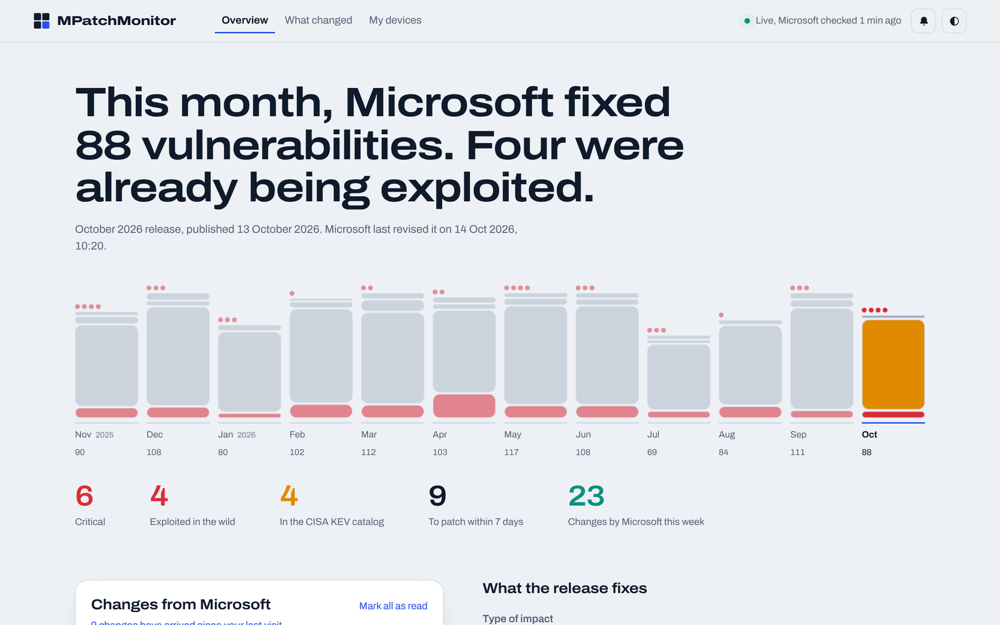

| My devices | What changed | Evidence report |
|---|---|---|
| 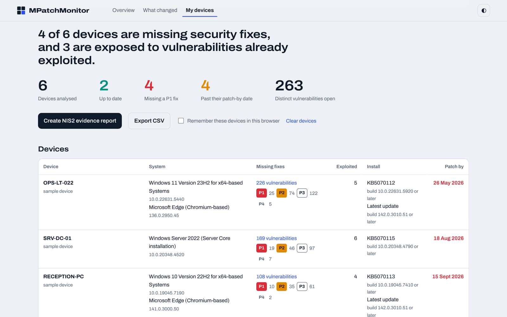 | 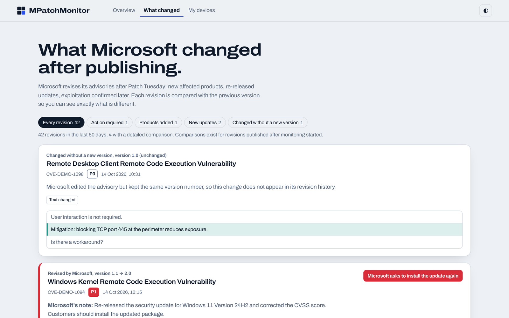 | 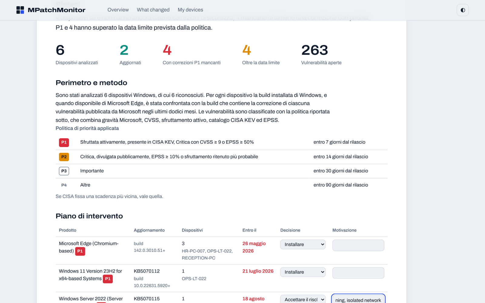 |

| Security update | CSIRT Italia monitor | Exploited, every vendor |
|---|---|---|
| 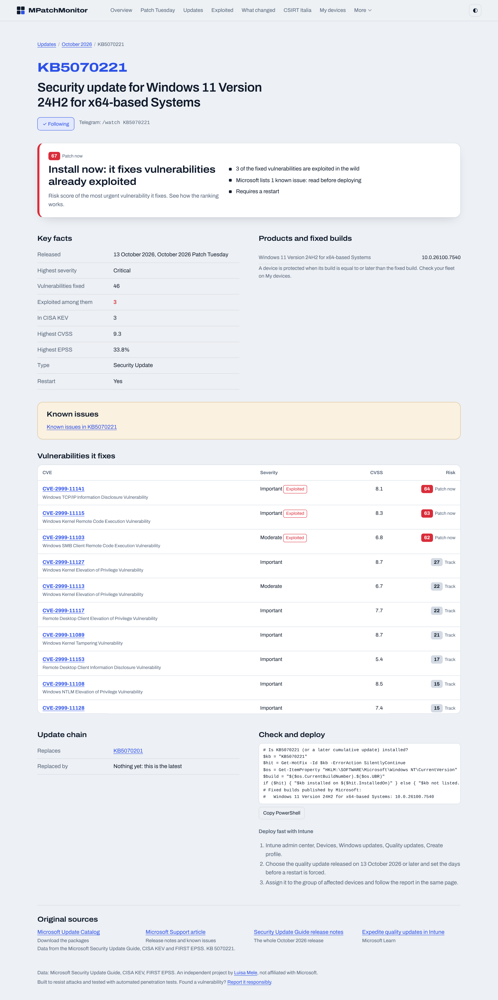 | 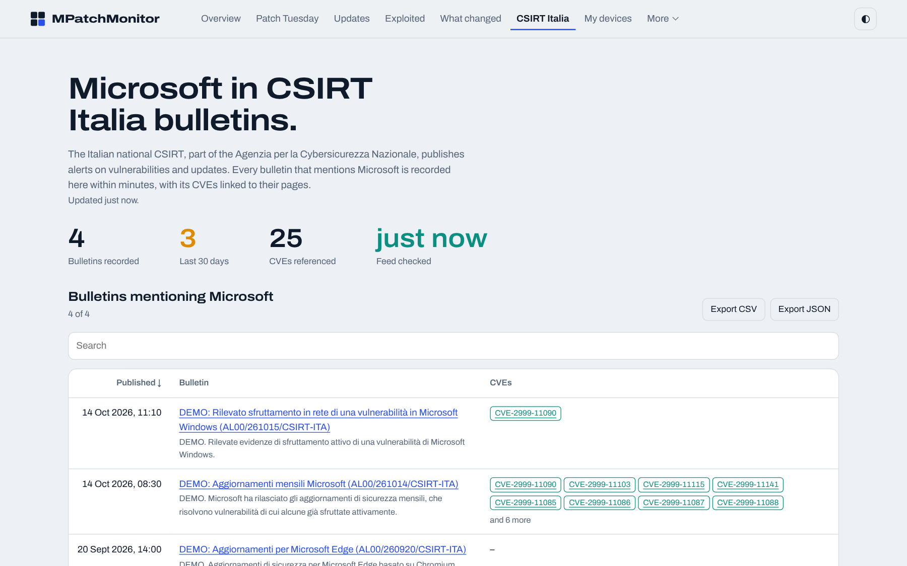 | 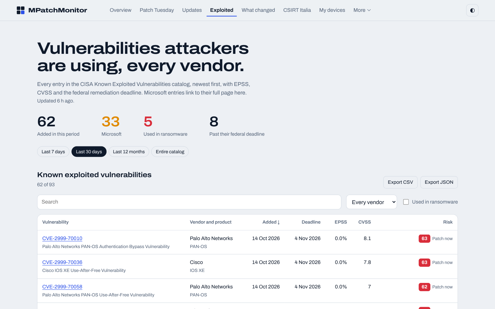 |

| Trends | Monthly analysis | My software |
|---|---|---|
| 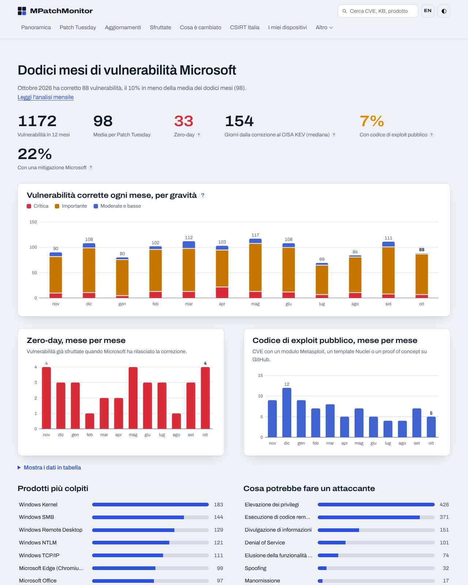 | 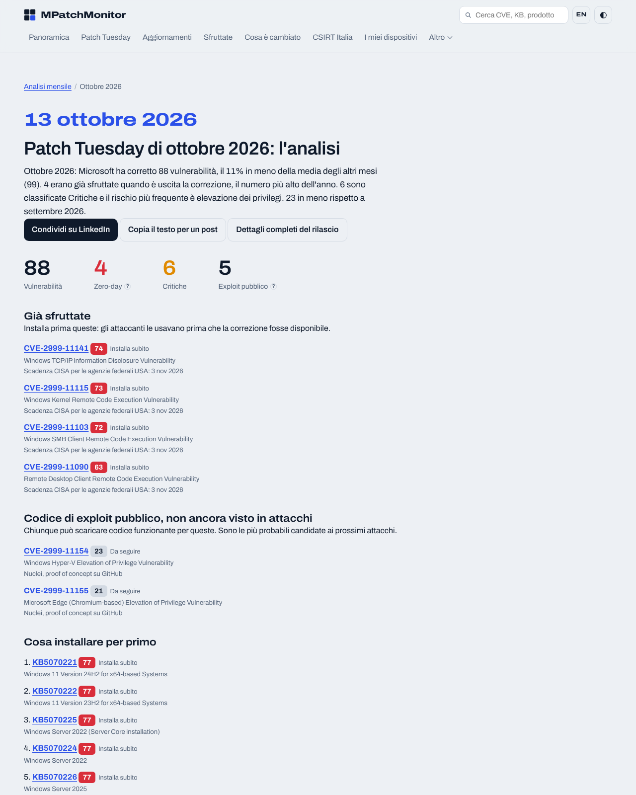 | 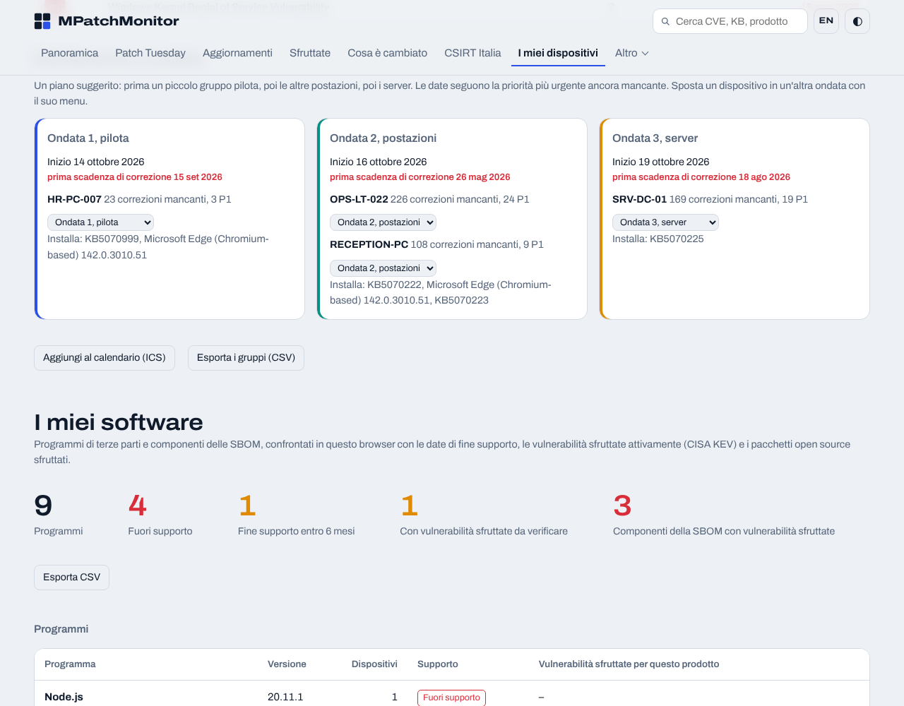 |

*Screenshots and the [sample report](docs/sample-evidence-report.pdf) use demo data and a fictional organisation.*

## How each part works

### My devices: private by design
- **Inputs:** the output of a small read-only PowerShell collector (`collect.ps1`: Windows build and revision, Edge and Microsoft 365 Apps versions, installed updates; no admin rights, no network access), or a device export from **Intune** or **Defender for Endpoint**.
- **Matching:** each device is mapped to the product names Microsoft uses in its bulletins (Windows 10/11 by version and architecture, Windows Server including Server Core, Microsoft Edge). The installed build is compared with the `FixedBuild` Microsoft publishes for every fix, so cumulative updates are handled correctly.
- **Output:** missing vulnerabilities per device ranked P1 to P4, exploited and KEV exposure, the update (KB) to install, patch-by dates and overdue devices, plus the vulnerabilities open across the fleet.
- **Rollout in waves:** a suggested plan (pilot workstations, other workstations, servers) with dates driven by the most urgent missing fix; move devices between waves, export it as CSV or as calendar events (ICS). The plan goes into the evidence report.
- **Remediation scripts per wave:** a PowerShell script that checks each device's build and installs the missing updates through Windows Update (report-only unless `-Install`), an Intune expedited quality update profile through Microsoft Graph, and a WSUS approval script for a computer group named after the wave. Device names and KB numbers are filtered before they reach a script.
- **My software:** the collector also lists installed programs (`-NoSoftware` turns it off); you can add an SBOM (**CycloneDX** or **SPDX**), a `winget export` or a CSV. Programs are checked against end-of-life dates and CISA KEV, SBOM components against exploited open-source packages with the fixed version.
- **Privacy:** files are read with the browser's File API. The page's Content-Security-Policy only allows connections to this site, and the site exposes no endpoint that accepts data.

### What changed
- The data pipeline keeps a snapshot of every advisory (description and FAQ text, affected products, updates and fixed builds, CVSS, exploitation flags, customer action).
- When Microsoft publishes a revision, the new version is compared with the snapshot: sentence-level text diff, products and updates added or removed, score and flag changes.
- Edits made **without a new version number** are detected too, because the comparison does not rely on Microsoft's revision history.

### Evidence report
- Summary, scope and method, priority policy, action plan with a decision for each action (install, mitigate, accept the risk) and its rationale, device detail, highest-priority vulnerabilities, regulatory references, limitations and approval by the management body.
- Prints to PDF and exports a machine-readable JSON with its SHA-256 hash.
- References live in `public/report-refs.js` so they can be reviewed against the official texts.

## English and Italian

The whole site is available in **English and Italian**: pages, data labels, dates, the evidence report, the Telegram bot and its alerts.

- The language comes from `?lang=en|it` (remembered in a cookie), or from the browser's preferred language. The **IT/EN** button in the header switches it on any page.
- The Worker translates the static HTML with `HTMLRewriter` before sending it, so each page arrives complete in its language, works without waiting for scripts, and publishes `hreflang` alternates for search engines.
- Text written by others is shown as published: Microsoft's CVE titles and revision notes stay in English, CSIRT Italia bulletins stay in Italian, product names are never translated.
- One source of truth, `i18n/it.json`. `tools/i18n.py` marks the pages, generates the translation tables and fails the tests when a visible string has no translation.

```bash
python tools/i18n.py mark && python tools/i18n.py build   # after changing a page or a translated string
```

| Italiano | Mobile |
|---|---|
| 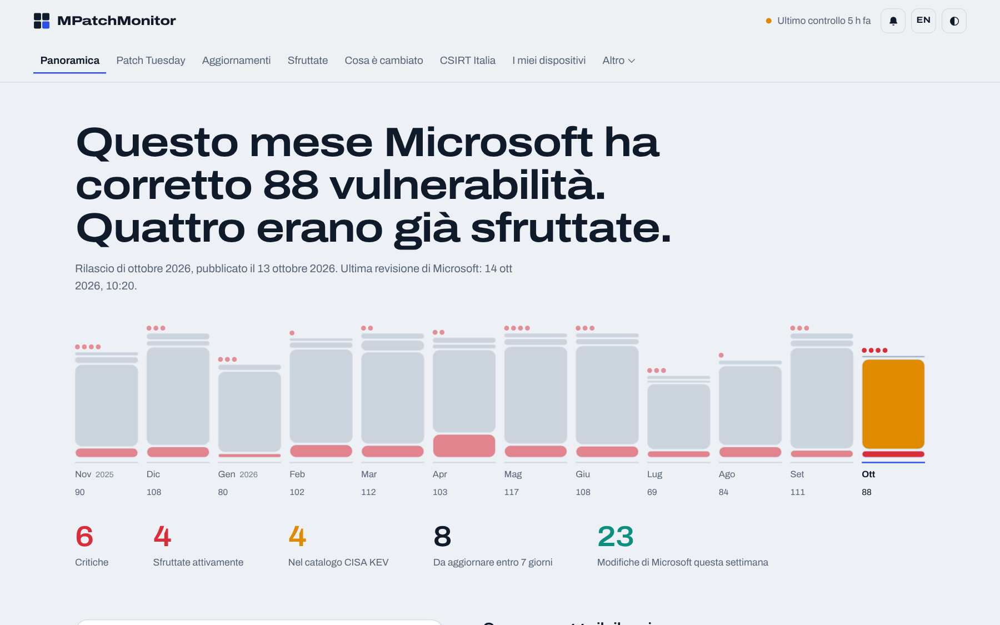 | 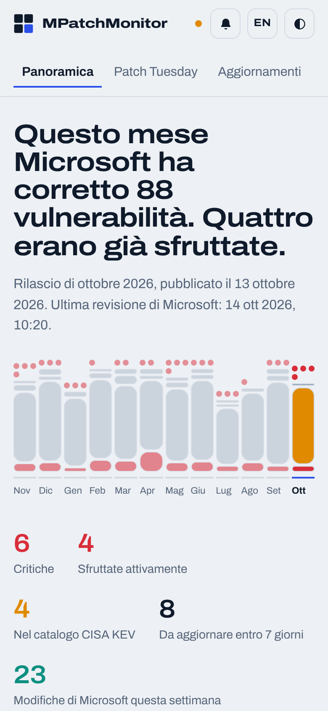 |

## Free trackers, feeds and alerts

Everything below is free, with no account, no key and no paywall.

| Section | What it shows |
|---|---|
| **Patch Tuesday** | Every release of the last twelve months: zero-days, most urgent fixes, where the fixes are, updates to deploy, matching CSIRT Italia bulletin |
| **Updates (KB catalog)** | Every Microsoft security update with the CVEs it fixes, exploitation, risk score, known issues, supersedence, fixed builds, restart, a PowerShell check and Intune expedite steps; jump to any KB |
| **Exploited** | The whole CISA KEV catalog, every vendor, with EPSS, CVSS, ransomware use and deadlines; last 7/30/365 days |
| **Hottest right now** | Four ranked lists (everything, Microsoft, other vendors, updates) by a transparent 0 to 100 risk score |
| **CSIRT Italia** | Every bulletin of the Italian national CSIRT (ACN) that mentions Microsoft, recorded within 15 minutes, with CVEs linked to their pages; also in the evidence report as ID.RA-08 evidence |
| **Open-source fixes** | Exploited vulnerabilities mapped to open-source packages and the first fixed version (GitHub Advisory Database) |
| **End of life** | Support end dates for Microsoft and other widely used products |
| **Data breaches** | Verified breaches (Have I Been Pwned) and SEC Form 8-K Item 1.05 incident filings |
| **Microsoft docs tracker** | Changes of the last two weeks to the security documentation of Entra ID, Intune, Defender, Windows and Graph |
| **Alerts** | Telegram bot in English or Italian (`/watch exploited`, `/watch acn`, `/watch KB…`, `/watch CVE-…`, `/lang it`), Follow buttons with in-browser notices, public alert log |
| **Feeds and API** | RSS feeds, JSON API with ETags, Patch Tuesday calendar (ICS) and a read-only **MCP server** for AI assistants |
| **Trends** | Twelve months at a glance: vulnerabilities by severity, zero-days and public exploit code per month, median days from fix to CISA KEV, most affected products; with a table view and CSV |
| **Monthly analysis** | An automatic, plain-language analysis of every Patch Tuesday in Italian and English, ready to share on LinkedIn |
| **Browser notifications** | Web Push from the site itself (no third-party service, encrypted per browser, VAPID-signed); the site can be installed as an app on computer and phone |
| **Embed** | A Patch Tuesday card for other websites: a plain SVG image, no script, no cookies |
| **Windows known issues** | Microsoft's release health for every supported Windows version: the update that started each issue, status, workaround and the update that fixes it; also on each KB page and as a `/watch issues` alert |
| **Detect and hunt** | On every CVE: KQL queries for Defender XDR advanced hunting and Sentinel (exposed devices, context, Defender's knowledge base, alerts), MITRE ATT&CK techniques (CTID mappings or a labelled suggestion) and Sigma rules; on every KB, the devices that still need it; on *Exploited*, one query for the whole filtered list |
| **EPSS over time** | A sparkline of the exploitation probability for the last month on every CVE page |
| **Glossary and status** | Every term explained (the small "?" next to labels), and the freshness of every data source |

Every CVE and update page also shows **public exploit code** (Metasploit, Nuclei, PoC-in-GitHub, which add 10 points to the risk score) and, under *If you cannot install yet*, the **workarounds and mitigations** Microsoft publishes. Every page publishes **structured data** (JSON-LD) and the site has a **sitemap** with Italian and English alternates; each monthly analysis has its own **preview image** for LinkedIn. A **global search** in the header finds any CVE, KB, product or page (press `/`).

Every list exports to CSV and JSON. The ranking method is documented on the site (*How the ranking works*).

## Also included

- **Overview** of the last 12 Patch Tuesdays, a live feed of Microsoft changes and a remediation queue, enriched with the **CISA KEV** catalog and **FIRST EPSS**.
- **A page for every CVE** with the reasons behind its priority, risk score, the decoded CVSS vector, revision history, the updates that fix it, CSIRT Italia mentions, affected products and links to Microsoft, NVD, CVE.org, CISA and FIRST.
- **Near real time:** a Cloudflare Worker checks the Microsoft Security Update Guide every five minutes and CSIRT Italia every fifteen, triggers the pipeline when something changes, and open pages update by themselves.

## Architecture

```
            every 5 min                               when Microsoft changes something
┌─────────────────────────────┐   MSRC index   ┌──────────────────────────────────────────┐
│ Cloudflare Worker (cron)    │ ─────────────► │ GitHub Actions (Python pipeline)          │
│  fingerprints the releases  │  dispatch      │  MSRC CVRF: CVEs, fixes, KBs, known       │
│  CSIRT Italia feed (15 min) │                │  issues; CISA KEV; FIRST EPSS; NVD;       │
│  Telegram + Web Push outbox │                │  endoflife.date; GitHub advisories and    │
│  state -> D1                │                │  docs; HIBP; SEC EDGAR                    │
└─────────────────────────────┘                │  snapshot diff -> revisions explained     │
                                               │  datasets and feeds (changed only) -> KV  │
                                               └──────────────────────────────────────────┘
┌──────────────────────────────────────────────────────────────┐
│ Cloudflare Worker (public site)                              │
│  request guard: rate limiting, attack detection, IP blocks   │
│  pages, /cve/<id>, /kb/<id>, /release/<id>, /api/*, /feed/*, │
│  /ics/*, /mcp (read-only MCP server), /tg/webhook,           │
│  /embed/*.svg, /api/push/* (Web Push subscriptions)          │
│  device matching and report generation run in the browser    │
└──────────────────────────────────────────────────────────────┘
┌──────────────────────────────────────────────────────────────┐
│ Separate admin Worker (private hostname, not in this repo)   │ ──► Telegram alerts
│  passkey sign-in, blocked IPs, security events, allowlist    │
└──────────────────────────────────────────────────────────────┘
```

Everything runs on free tiers: Cloudflare Workers, Static Assets, KV, D1, Cron Triggers and Rate Limiting, plus GitHub Actions on a public repository.

## Security

The site is designed against attacks and tested with automated penetration tests:

- **Request guard** on every dynamic route: per-IP rate limiting, detection of trap paths, attack payloads and scanner tools, automatic blocking with escalation for repeat offenders, IPv6 blocked per /64.
- **Telegram alerts** for every block and admin sign-in; blocks can be lifted from a private admin console that signs in with **passkeys** (WebAuthn, user verification required).
- **Browser hardening:** strict Content-Security-Policy without `unsafe-inline`, Trusted Types, COOP/COEP/CORP, HSTS, no framing; all data escaped, hostile inventory files and advisory text tested; CSV formula injection neutralised.
- **Availability on the free plan:** static files never invoke the Worker; frequent writes go to D1 so KV's shared quota stays free.

Details and residual risks: [docs/SECURITY-ASSESSMENT.md](docs/SECURITY-ASSESSMENT.md). To report a vulnerability: [SECURITY.md](SECURITY.md).

## Repository layout

```
public/            pages, styles, browser logic (match.js: device matching, report.js: evidence), collect.ps1
worker/            public Cloudflare Worker: routes, request guard, MSRC and CSIRT Italia watchers, Watch bot, MCP server, feeds, tests
migrations/        D1 schema
i18n/              Italian translations (it.json), single source for pages, scripts and the bot
scripts/           Python pipeline: MSRC, KEV, EPSS, fixes index, KB catalog, trackers, feeds, snapshots and revision diffs
tests/             pipeline, translation and device-matching unit tests
tools/             i18n.py (translations), vapid.mjs (Web Push keys), publish-github.ps1 (publishes only the public files)
security/          penetration test suite and DOM XSS checks
.github/workflows  data pipeline (event driven and hourly)
```

## Running the tests

```bash
npm install && npm test                                  # Worker, security and matching tests
pip install -r requirements.txt -r requirements-dev.txt && pytest -q   # pipeline and translation tests
npm run dev                                              # local site on http://localhost:8787
python security/pentest.py --public http://localhost:8787 --report security/reports/pentest.md
```

## Priority model

| Priority | When | Patch within |
|---|---|---|
| **P1** | Exploited in the wild, in CISA KEV, Critical with CVSS ≥ 9, or EPSS ≥ 50% | 7 days |
| **P2** | Critical, publicly disclosed, public exploit code, EPSS ≥ 10%, or "Exploitation More Likely" | 14 days |
| **P3** | Important | 30 days |
| **P4** | Everything else | 90 days |

## Data sources

[Microsoft Security Update Guide API](https://api.msrc.microsoft.com/cvrf/v3.0/updates), [CISA Known Exploited Vulnerabilities](https://www.cisa.gov/known-exploited-vulnerabilities-catalog), [FIRST EPSS](https://www.first.org/epss/), [NIST NVD](https://nvd.nist.gov/), [CSIRT Italia (ACN)](https://www.acn.gov.it/portale/feedrss/-/journal/rss/20119/723192), [endoflife.date](https://endoflife.date/), [GitHub Advisory Database](https://github.com/advisories), [Microsoft documentation on GitHub](https://github.com/MicrosoftDocs), [Have I Been Pwned](https://haveibeenpwned.com/), [SEC EDGAR](https://www.sec.gov/edgar/search/), [Metasploit module metadata](https://github.com/rapid7/metasploit-framework), [Nuclei templates](https://github.com/projectdiscovery/nuclei-templates), [PoC-in-GitHub](https://github.com/nomi-sec/PoC-in-GitHub), [Windows release health](https://learn.microsoft.com/windows/release-health/), [MITRE CTID Mappings Explorer](https://github.com/center-for-threat-informed-defense/mappings-explorer), [SigmaHQ](https://github.com/SigmaHQ/sigma). Each page credits its sources; follow their licences when reusing the data.

## Author

**Luisa Mele**, Cybersecurity & Cloud Engineer, Governance & Compliance (NIS2, ISO 27001, GDPR). [GitHub](https://github.com/MariSeest)

Independent project, not affiliated with or endorsed by Microsoft. The evidence report supports, but does not replace, a compliance assessment. Released under the MIT License. The Archivo typeface is licensed under the SIL Open Font License.
